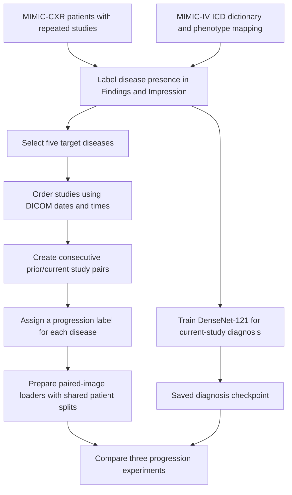

# Longitudinal Chest X-ray Disease Progression

This project compares **a patient's prior and current chest X-rays** to classify how each disease has changed: **improving, stable, or worsening**.

Because the model sees both examinations, the task is **longitudinal progression classification**, rather than prediction of an unseen future outcome. Some existing filenames use `prognosis` for these progression labels.

## Project flow



### 1. Select patients with repeated examinations

The cohort helper selects patient folders with at least two report files. Study dates and times from DICOM metadata then establish chronological order for pairing.

Several DICOM images from one examination count as **one study**, not several visits. Studies with missing or ambiguous ordering information are reported in `ordering_issues.csv`; the current pairing implementation excludes affected patients from pairing.

### 2. Build the disease vocabulary

Read `hosp/d_icd_diagnoses.csv` from MIMIC-IV and map ICD diagnosis names to grouped phenotype names. Save the vocabulary as `unique_diseases.csv`.

This dictionary supplies names for report matching. It does not establish that a patient has a disease.

### 3. Label disease presence in each report

Scan only the **Findings and Impression** sections. Disease matching, negation, and uncertainty rules produce report-derived states:

- **Positive:** the disease is asserted.
- **Negative:** the disease is explicitly negated.
- **Uncertain:** its presence is uncertain.
- **Unmentioned:** there is no recognized mention; this does not mean absence.

Conflicting or failed labels are retained for review. Manual decisions in the disease review queue can override automatic states.

Count positive patients and studies, then focus on these five findings for this experiment:

1. Pleural effusion
2. Cardiomegaly
3. Edema
4. Pneumonia
5. Pulmonary edema

**Edema and Pulmonary edema overlap under the current matching rules**, so they are not independent disease categories.

### 4. Build disease-specific progression targets

For a patient with five chronologically ordered studies, create four consecutive pairs:

```text
Study 1 → Study 2
Study 2 → Study 3
Study 3 → Study 4
Study 4 → Study 5
```

The script does not automatically label Study 1 → Study 5.

Combine disease-linked comparison wording with explicit disease-presence transitions:

| Evidence | Candidate progression |
|---|---|
| Improved, decreased, resolved | Improving |
| Stable, unchanged | Stable |
| Worsened, increased, new | Worsening |
| Positive → explicit negative | Improving |
| Explicit negative → positive | Worsening |
| Positive → positive without comparison evidence | No comparison |
| Disease becomes unmentioned | No transition inferred |
| Report trend and presence transition disagree | Mixed; review required |

The lenient text rules use nearby trend cues and majority voting; uncertainty and ambiguous attachments remain flagged for review. A later report's comparison may refer to a different earlier examination, so its reference must be verified before treating the pair as validated.

Each image pair has **five separate targets**. For example, effusion can worsen while edema improves. The paired task includes both positive-input cases and negative-to-positive onset cases.

Automatic candidate labels are used for exploratory experiments. They are not manually validated ground truth.

### 5. Prepare images and patient splits

- Reuse `prognosis_patient_splits.csv` for diagnosis and progression experiments.
- Keep every study and pair from one patient in a single train, validation, or test split.
- Select one DICOM per study: prefer the first AP/PA image in sorted file order; otherwise use the first file.
- Apply DICOM rescaling, padding and grayscale-polarity handling, percentile scaling, resizing to 224 × 224, and ImageNet normalization.
- Supply prior and current images separately. The loader currently decodes DICOMs on demand, without a preprocessed-image cache.

The prepared pair CSV stores both image paths, the assigned split, and five targets:

```text
Disease order: Pleural effusion, Cardiomegaly, Edema, Pneumonia, Pulmonary edema
Target values: 0 = improving, 1 = stable, 2 = worsening, -100 = ignore
```

Mixed and no-comparison targets are masked **per disease**. A pair remains usable when at least one disease has an eligible target.

## Model experiments

### Diagnosis backbone

Fine-tune an ImageNet-initialized DenseNet-121 on individual images to predict four report-derived states for each of the five diseases. Save the checkpoint with the lowest validation loss. This checkpoint initializes the two pretrained progression experiments.

### Progression comparison

All three experiments use the same pair manifest and patient assignments.

| Experiment | Initialization | What is trained? |
|---|---|---|
| Frozen-feature baseline | Diagnosis checkpoint | Separate PCA and logistic-regression classifier for each disease; DenseNet stays frozen |
| Paired fine-tuning | Diagnosis checkpoint | Shared DenseNet encoder and a new five-disease progression head |
| Paired training from scratch | Random weights, without ImageNet or diagnosis pretraining | The same paired encoder and progression head |

Both images pass through the shared encoder. The classifier uses **current features minus prior features**.

For the frozen baseline, fit PCA on training data only and select logistic-regression regularization using validation macro F1.

For the neural models, use masked cross-entropy and select the best checkpoint by validation loss. Current settings use 20 epochs and cosine learning-rate decay:

| Experiment | Backbone learning rate | Head learning rate |
|---|---|---|
| Paired fine-tuning | `1e-5 → 1e-6` | `1e-4 → 1e-5` |
| Paired training from scratch | `1e-4 → 1e-5` | `1e-4 → 1e-5` |

The neural comparison therefore differs in initialization **and backbone learning rate**. The frozen baseline additionally differs in classifier and training method.

## Running the project

Open **`main_notebook_clean.ipynb`** and select the Python environment containing CUDA-enabled PyTorch if using an NVIDIA GPU.

1. Update the project/data paths and checkpoint path in Section 1.
2. Run the imports, settings, and data-preparation sections. Existing generated labels are reused by default.
3. Enable the experiments to run:

   ```python
   RUN_BACKBONE = False           # True to train a new diagnosis backbone
   RUN_FROZEN_BASELINE = True     # Frozen features + PCA/logistic regression
   RUN_PAIRED_FINETUNE = False    # Train paired model from diagnosis checkpoint
   RUN_PAIRED_SCRATCH = False     # Train paired model from random weights
   ```

4. Run the chosen experiment cells and the final comparison section.

Dependencies include PyTorch, torchvision, NumPy, pandas, pydicom, Pillow, tqdm, scikit-learn, and joblib. Vocabulary construction also requires its mapping resources. Compressed DICOMs may require an appropriate pydicom decoder.

Set `REBUILD_LABELS` or `REBUILD_PAIRS` only when intentionally regenerating those files. Preserve manual review decisions before rebuilding review queues. Changing the candidate/reviewed-label policy requires regenerating the pair manifest.

## Main files

```text
main_notebook_clean.ipynb          Main workflow and experiment comparison
labelling/
    Build_disease_vocab.py        ICD/phenotype vocabulary construction
    scan_disease_v2.py            Disease-presence report labeling
    count_positive_cases.py       Positive patient/study counts
    build_prognosis_labels.py     Chronological pairs and progression targets
data_loader/
    cxr_backbone_dataloader.py    Individual-study diagnosis loader
    cxr_pair_dataloader.py        Pair CSV preparation and five-target loader
    cxr_prognosis_dataloader.py   Shared DICOM preprocessing and label utilities
model/
    cxr_backbone.py               Diagnosis DenseNet
    train_backbone.py            Diagnosis training
    progression_model.py         Frozen feature extractor and PCA/LR fitting
    train_progression.py         Frozen-baseline experiment
    paired_progression_model.py  Trainable paired-image network
    train_paired_progression.py   Fine-tuning and scratch training
```

Each run writes a separate directory under `training_outputs/` containing checkpoints or classifiers, settings, training history, and evaluation results as applicable.

## Interpreting the results

Report accuracy, macro F1, class support, and confusion matrices separately for each disease. The frozen baseline also reports AUROC/AUPRC where the required classes are present. Small and imbalanced evaluation sets can make these scores unstable.

Diagnosis counts refer to positive individual studies. Progression counts refer to eligible **study pairs**. These totals are different by design; one pair can contribute labels to several diseases.

Use validation data for model choices. Evaluate the selected models on held-out test patients. A two-class overall change detector and a three-class disease-specific model do not have directly comparable accuracy scores.
